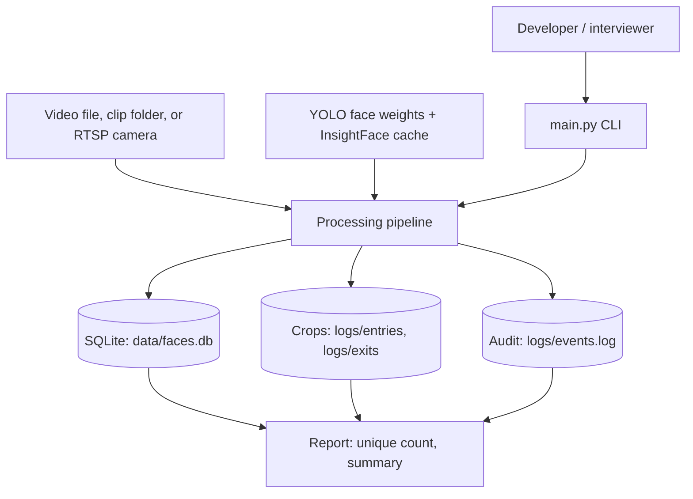
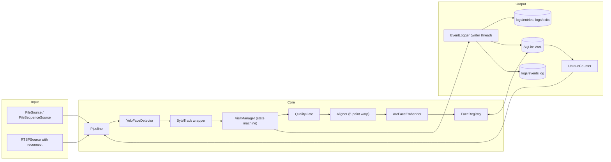
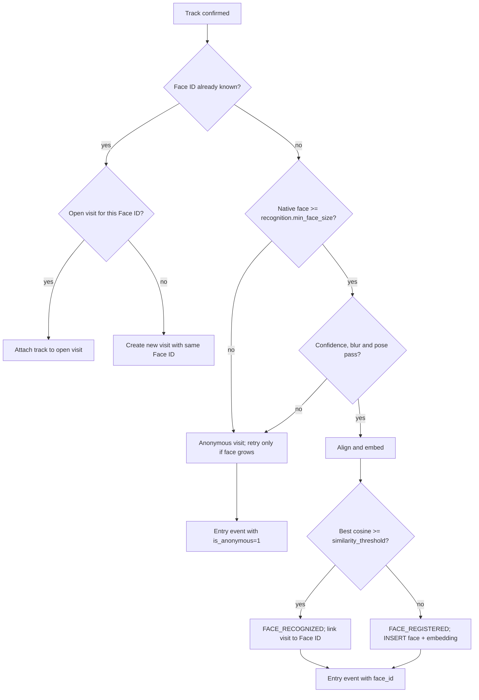
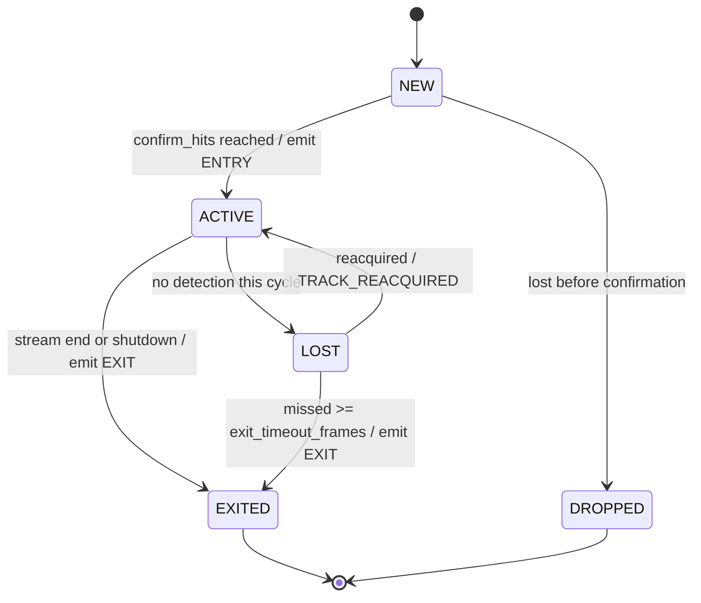
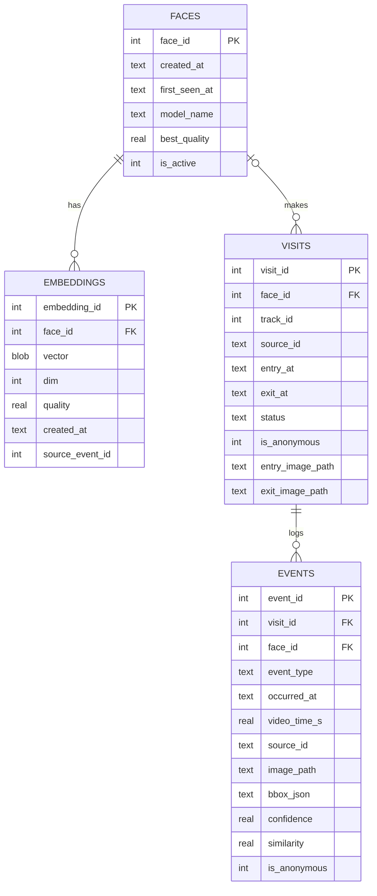
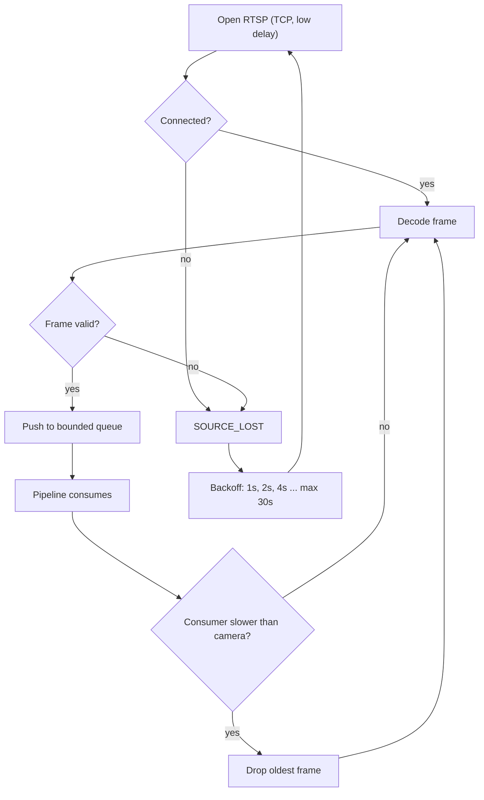

# ARCHITECTURE — Intelligent Face Tracker

> Companion to [`PLAN.md`](./PLAN.md) and [`FEATURES.md`](./FEATURES.md).
> Diagrams use Mermaid and render on GitHub, GitLab and VS Code.

---

## 1. Context



The system is a single local Python process. It reads one stream, writes three
artefacts, and exposes a DB-derived count. There is no network dependency at
runtime after model download.

---

## 2. Components



### Module responsibilities

| Module | Responsibility | Depends on |
|---|---|---|
| `src/config` | Load and validate JSON into frozen typed config | — |
| `src/video` | Decode files/folders/RTSP into `Frame` objects; reconnect | config, logging |
| `src/detection` | YOLO face inference; native-coordinate boxes; detect-only checkpoint | config, types |
| `src/recognition` | Quality gate, alignment, ArcFace embedding, cosine registry | config, storage |
| `src/tracking` | ByteTrack association, track lifecycle, visits | config, recognition, events |
| `src/events` | Atomic image writes, event + visit persistence, audit log | config, storage |
| `src/storage` | SQLite connection, schema, repositories | config |
| `src/counting` | DB-derived unique count and summary | storage |
| `src/pipeline` | Frame loop, cadence, orchestration, shutdown | all of the above |
| `src/logging_setup` | Console/file handlers, formatters | config |
| `main.py` | Composition root and CLI. Wires concrete classes. | all |

**Dependency rule:** business classes never instantiate infrastructure. The
detector, embedder, tracker, source, database, logger and clock are passed into
constructors. Tests inject fakes.

### Core types and interfaces

```python
from dataclasses import dataclass
from datetime import datetime
from enum import Enum
from typing import Iterator, Protocol
import numpy as np


@dataclass(frozen=True)
class Frame:
    index: int                 # index within the current source window
    timestamp_s: float         # seconds from the start of the source window
    absolute_time: datetime    # UTC, derived from clip name or wall clock
    image: np.ndarray          # BGR, native resolution


@dataclass(frozen=True)
class FaceDetection:
    bbox: tuple[float, float, float, float]  # x1, y1, x2, y2 in native pixels
    confidence: float
    keypoints: np.ndarray | None             # None with the detect-only checkpoint


@dataclass(frozen=True)
class QualityResult:
    passed: bool
    score: float
    reason: str | None


class TrackState(str, Enum):
    NEW = "new"
    ACTIVE = "active"
    LOST = "lost"
    EXITED = "exited"
    DROPPED = "dropped"


@dataclass
class TrackedFace:
    track_id: int
    bbox: tuple[float, float, float, float]
    confidence: float
    keypoints: np.ndarray | None
    state: TrackState
    face_id: int | None
    visit_id: int | None
    first_seen_frame: int
    last_seen_frame: int
    missed_frames: int
    best_crop: np.ndarray | None
    best_quality: float


class VideoSource(Protocol):
    def frames(self) -> Iterator[Frame]: ...
    def close(self) -> None: ...


class FaceDetector(Protocol):
    def detect(self, image: np.ndarray) -> list[FaceDetection]: ...


class Embedder(Protocol):
    def embed(self, aligned_face_bgr: np.ndarray) -> np.ndarray: ...


class FaceRegistry(Protocol):
    def match(self, vector: np.ndarray) -> tuple[int | None, float]: ...
    def register(self, vector: np.ndarray, quality: float,
                 now: datetime) -> int: ...


class Tracker(Protocol):
    def update(self, detections: list[FaceDetection],
               frame_index: int) -> list[TrackedFace]: ...


class EventSink(Protocol):
    def entry(self, visit_id: int, face_id: int | None,
              image: np.ndarray, meta: dict) -> None: ...
    def exit(self, visit_id: int, face_id: int | None,
             image: np.ndarray, meta: dict) -> None: ...
    def flush(self) -> None: ...
```

Contracts:

- The detector always returns **native-pixel** boxes; resizing is its internal
  concern.
- The bundled `yolov8n-face` checkpoint is detect-only, so `keypoints` is
  normally `None`. The aligner must derive 5 points with InsightFace landmarks
  when the detector cannot supply them.
- The embedder receives a 112×112 aligned BGR crop and returns a float32 vector
  with unit L2 norm.
- The registry is confined to the pipeline thread; it is not thread-safe.
- The event sink is idempotent per `(visit_id, event_type)`.
- `first_seen_frame` drives the entry timestamp; `last_seen_frame` drives the
  exit timestamp.

---

## 3. Frame-processing sequence

```mermaid
sequenceDiagram
    autonumber
    participant S as VideoSource
    participant P as Pipeline
    participant D as YoloFaceDetector
    participant T as ByteTrack
    participant V as VisitManager
    participant Q as QualityGate
    participant A as Aligner
    participant E as ArcFaceEmbedder
    participant R as FaceRegistry
    participant W as EventLogger
    participant DB as SQLite

    S->>P: Frame(index, timestamp, image)
    alt index % frame_skip == 0 (detection cycle)
        P->>D: detect(image)
        D-->>P: FaceDetection[]
        P->>T: update(detections, index)
        T-->>P: TrackedBox[]
        loop each tracked box
            P->>V: observe(track, frame)
            alt NEW and hits >= confirm_hits
                V->>Q: assess(crop, keypoints, native_size)
                Q-->>V: quality / reject reason
                alt quality passes and no Face ID yet
                    V->>A: align(crop, keypoints)
                    A-->>V: 112x112 aligned face
                    V->>E: embed(aligned)
                    E-->>V: 512-d normalised vector
                    V->>R: match(vector)
                    alt similarity >= threshold
                        R-->>V: existing face_id
                    else unmatched
                        R->>DB: INSERT face + embedding
                        R-->>V: new face_id
                    end
                end
                V->>W: emit_entry(visit, face, crop)
                W->>DB: INSERT entry event + visit
                W->>W: write crop atomically
            else ACTIVE with no Face ID and retry due
                V->>V: retry quality/embed/match
            else ACTIVE with Face ID
                V->>V: update best crop only
            end
        end
        P->>V: expire_tracks(index)
        V->>W: emit_exit(visit, crop) when EXITED
    else skipped frame
        P->>P: reuse last boxes; no inference
    end
```

Key properties:

- Inference and embedding run **only on detection cycles**.
- Embedding runs **only while a track has no Face ID** (or a better embedding is
  worth adding), never on every frame.
- Entry is emitted after confirmation, but timestamped at **first sight**.
- Exit is emitted at timeout, timestamped at **last sight**.

---

## 4. Identity decision flow



An anonymous visit never becomes a registered visitor retroactively within the
same visit. If the face later becomes large enough and is registered, the open
visit and its events are updated to carry the new Face ID; the unique count
increments once. If the visit already exited, a later appearance is a new visit
linked to the existing Face ID.

---

## 5. Track and visit state machine



Rules:

1. **One entry per visit.** Emitted exactly once on `NEW → ACTIVE`.
2. **One exit per visit.** Emitted exactly once on `EXITED`, enforced by
   `UNIQUE(visit_id, event_type)`.
3. **Temporary loss is not an exit.** `LOST` keeps the same visit and entry
   timestamp; reacquisition before the timeout returns to `ACTIVE`.
4. **A real exit closes the visit forever.** A later appearance creates a new
   visit with the same Face ID; the unique count does not change.
5. **End of stream is an exit.** Every active or lost track is flushed on clip
   end, stream end, RTSP permanent loss, or graceful shutdown.
6. **Dropped tracks never produce events.** Confirmation prevents one-frame
   false positives from entering the registry or the event log.

---

## 6. Data model



### Invariants

- `events (visit_id, event_type)` is **unique**: at most one entry and one exit
  per visit.
- `visits.face_id` is `NULL` only for anonymous visits.
- `visits.status` is `open` while the track is alive, `closed` after exit.
- `visits.exit_at >= visits.entry_at` when both are present.
- `events.face_id` equals `visits.face_id` for linked visits.
- `visits.entry_image_path` / `exit_image_path` are denormalised copies of the
  two event image paths, written in the same transaction. `events` remains the
  source of truth; a mismatch is a bug surfaced by `scripts/verify_outputs.py`.
- `embeddings.dim = 512`; vector is float32 little-endian, L2-normalised.
- `unique_visitors = COUNT(*) FROM faces WHERE is_active = 1`.

### Schema (SQLite)

```sql
PRAGMA journal_mode = WAL;
PRAGMA synchronous = NORMAL;
PRAGMA foreign_keys = ON;
PRAGMA busy_timeout = 5000;

CREATE TABLE IF NOT EXISTS faces (
    face_id       INTEGER PRIMARY KEY AUTOINCREMENT,
    created_at    TEXT    NOT NULL,
    first_seen_at TEXT    NOT NULL,
    model_name    TEXT    NOT NULL,
    best_quality  REAL    NOT NULL DEFAULT 0.0,
    is_active     INTEGER NOT NULL DEFAULT 1 CHECK (is_active IN (0, 1))
);

CREATE TABLE IF NOT EXISTS embeddings (
    embedding_id    INTEGER PRIMARY KEY AUTOINCREMENT,
    face_id         INTEGER NOT NULL REFERENCES faces(face_id) ON DELETE CASCADE,
    vector          BLOB    NOT NULL,
    dim             INTEGER NOT NULL,
    quality         REAL    NOT NULL,
    created_at      TEXT    NOT NULL,
    source_event_id INTEGER
);

CREATE TABLE IF NOT EXISTS visits (
    visit_id        INTEGER PRIMARY KEY AUTOINCREMENT,
    face_id         INTEGER REFERENCES faces(face_id),
    track_id        INTEGER NOT NULL,
    source_id       TEXT    NOT NULL,
    entry_at        TEXT    NOT NULL,
    exit_at         TEXT,
    status          TEXT    NOT NULL CHECK (status IN ('open', 'closed')),
    is_anonymous    INTEGER NOT NULL DEFAULT 0 CHECK (is_anonymous IN (0, 1)),
    entry_image_path TEXT,
    exit_image_path  TEXT
);

CREATE TABLE IF NOT EXISTS events (
    event_id    INTEGER PRIMARY KEY AUTOINCREMENT,
    visit_id    INTEGER NOT NULL REFERENCES visits(visit_id),
    face_id     INTEGER REFERENCES faces(face_id),
    event_type  TEXT    NOT NULL CHECK (event_type IN ('entry', 'exit')),
    occurred_at TEXT    NOT NULL,
    video_time_s REAL   NOT NULL,
    source_id   TEXT    NOT NULL,
    image_path  TEXT    NOT NULL,
    bbox_json   TEXT,
    confidence  REAL,
    similarity  REAL,
    is_anonymous INTEGER NOT NULL DEFAULT 0 CHECK (is_anonymous IN (0, 1))
);

CREATE UNIQUE INDEX IF NOT EXISTS ux_events_visit_type
    ON events (visit_id, event_type);
CREATE INDEX IF NOT EXISTS ix_events_time
    ON events (occurred_at);
CREATE INDEX IF NOT EXISTS ix_visits_face
    ON visits (face_id, status);
```

### Why three tables instead of one

- `faces` is the identity registry and the source of truth for the unique count.
- `embeddings` allows up to three pose variants per identity without bloating
  the identity row.
- `visits` groups the two events and carries lifecycle state.
- `events` is the audit trail that the problem statement asks for.

---

## 7. Configuration

`config.json` is loaded once into frozen dataclasses and injected. No module
opens the file directly.

```json
{
  "source": {
    "type": "folder",
    "path": "src/video",
    "glob": "record_*.mp4",
    "rtsp_url": "",
    "realtime": false,
    "rtsp_transport": "tcp",
    "reconnect_max_backoff_sec": 30
  },
  "frame_skip": 3,
  "detector": {
    "model_path": "models/yolov8n-face.pt",
    "conf_threshold": 0.5,
    "imgsz": 1600,
    "min_face_size": 40,
    "device": "auto"
  },
  "recognition": {
    "model_name": "buffalo_l",
    "similarity_threshold": 0.45,
    "min_face_size": 60,
    "min_confidence": 0.6,
    "blur_threshold": 60.0,
    "register_quality_threshold": 0.65,
    "max_embeddings_per_face": 3,
    "retry_interval_sec": 1.0
  },
  "tracking": {
    "tracker": "bytetrack",
    "confirm_hits": 3,
    "exit_timeout_frames": 75,
    "lost_track_buffer": 30
  },
  "storage": {
    "db_path": "data/faces.db",
    "log_dir": "logs",
    "image_size": 256,
    "jpeg_quality": 90
  },
  "logging": {
    "level": "INFO",
    "max_bytes": 10485760,
    "backup_count": 5
  }
}
```

### Key semantics

| Key | Meaning |
|---|---|
| `source.type` | `file`, `folder`, or `rtsp`. `folder` reads `glob` in filename order. |
| `source.realtime` | `false` for files (process as fast as possible), `true` for RTSP (pace to stream, drop stale frames). |
| `frame_skip` | Decode every frame; run detection when `frame_index % frame_skip == 0`. Must be ≥ 1. |
| `detector.imgsz` | Inference size. 1600 default; 1280 for CPU real-time; 1920 on GPU. Measured CPU: 196/297/417 ms at 1280/1600/1920 on a 2K frame. |
| `detector.min_face_size` | Native-pixel minimum to create a track. |
| `detector.device` | `auto`, `cpu`, `cuda:0`. |
| `recognition.min_face_size` | Native-pixel minimum to embed or register. Must be ≥ detector gate. |
| `recognition.similarity_threshold` | Cosine threshold for re-identification. |
| `recognition.register_quality_threshold` | Higher bar for creating a new identity; prevents garbage registrations. |
| `recognition.max_embeddings_per_face` | Pose variants stored per identity. |
| `tracking.confirm_hits` | Detection cycles before `NEW → ACTIVE`. |
| `tracking.exit_timeout_frames` | **Source frames** missing before exit. 75 ≈ 3 s at 25 fps. Not detection cycles. |
| `tracking.lost_track_buffer` | ByteTrack buffer, in detection cycles (`frame_rate = fps / frame_skip`). |
| `storage.image_size` | Square crop saved on disk. |
| `logging.max_bytes` / `backup_count` | Rotation policy for `events.log` and `debug.log`. |

Validation (Phase 1) rejects: `frame_skip < 1`, `min_face_size <= 0`,
`similarity_threshold` outside `[0, 1]`, `rtsp` without URL, missing model
path, non-writable `log_dir`/`db_path` parent, unknown `source.type`,
`recognition.min_face_size < detector.min_face_size`.

---

## 8. Event log format

`logs/events.log` is the mandatory audit log. It is **not** the Python debug
log. Format:

```
<ISO-8601 UTC> | <EVENT_CODE> | key=value key=value ...
```

Example:

```
2025-06-20T18:39:04.120Z | FACE_DETECTED     | src=record_20250620_183903.mp4 t=1.12 track=7 bbox=812,640,76,76 conf=0.91 size=76
2025-06-20T18:39:04.160Z | EMBEDDING_GENERATED | track=7 face=- dim=512 quality=0.78
2025-06-20T18:39:04.180Z | FACE_REGISTERED   | track=7 face=17 similarity=0.21 threshold=0.45
2025-06-20T18:39:04.200Z | ENTRY             | visit=42 face=17 track=7 anon=false img=logs/entries/2025-06-20/2025-06-20T18-39-04.120_face17_visit42_track7.jpg
2025-06-20T18:39:07.900Z | TRACK_LOST        | track=7 face=17 missed=12
2025-06-20T18:39:09.040Z | EXIT              | visit=42 face=17 track=7 anon=false img=logs/exits/2025-06-20/...
2025-06-20T19:03:24.010Z | SOURCE_LOST       | src=rtsp reason=timeout
2025-06-20T19:03:25.020Z | SOURCE_RECONNECTED | src=rtsp attempt=1
2025-06-20T19:12:30.000Z | SUMMARY           | unique=137 visits=161 entries=161 exits=161 anonymous=24 open=0
```

Event codes: `FACE_DETECTED`, `EMBEDDING_GENERATED`, `FACE_REGISTERED`,
`FACE_RECOGNIZED`, `TRACK_STARTED`, `TRACK_LOST`, `TRACK_REACQUIRED`, `ENTRY`,
`EXIT`, `VISIT_LINKED`, `SOURCE_LOST`, `SOURCE_RECONNECTED`, `SHUTDOWN`,
`SUMMARY`. `QUALITY_REJECTED` is DEBUG-only.

Rules:

- Single line per event; values never contain newlines or the `|` separator.
- Paths are relative to the project root and use `/` for portability.
- Timestamps are UTC; the source clip timestamp is also carried in `t=` and in
  `events.video_time_s`.
- `FACE_DETECTED` is logged on track start and reacquisition, not on every
  cycle. Per-cycle detail goes to `logs/debug.log`.
- Rotating handler: 10 MB × 5 backups by default.

---

## 9. Storage layout

```
data/
  faces.db            # SQLite (WAL, .db-wal, .db-shm)
logs/
  events.log          # mandatory audit log (rotating)
  debug.log           # per-frame detail, disabled at INFO (rotating)
  entries/
    2025-06-20/
      2025-06-20T18-39-04.120_face17_visit42_track7.jpg
  exits/
    2025-06-20/
      2025-06-20T18-39-09.040_face17_visit42_track7.jpg
models/
  yolov8n-face.pt
```

Filenames use `-` instead of `:` (Windows-safe) and carry event time, Face ID,
Visit ID and Track ID so any log line, DB row and image can be cross-referenced.

---

## 10. RTSP resilience



Behaviour:

- `rtsp_transport=tcp` avoids UDP packet loss; `fflags=nobuffer` +
  `flags=low_delay` keep latency low.
- The decoder runs in its own thread; the frame queue holds at most 2–3 frames.
  A slow pipeline drops stale frames instead of accumulating delay.
- While disconnected, tracks are **frozen**, not flushed, until the gap exceeds
  `exit_timeout_frames`. This prevents a 5-second network blip from producing a
  wave of false exits.
- Reconnect is infinite with capped backoff; `SOURCE_LOST` and
  `SOURCE_RECONNECTED` are audit events.
- Credentials are read from an environment variable referenced as
  `${RTSP_URL}` in config; secrets are never logged.

---

## 11. Concurrency

| Thread | Owns | Notes |
|---|---|---|
| Decoder | Source, frame queue | PyAV/FFmpeg decode; bounded `queue.Queue(maxsize=3)` |
| Pipeline | Detection, tracking, visits, registry | Single-threaded frame loop; no shared mutable state with decoder |
| Event writer | Image files, DB writes, `events.log` | Bounded queue (100); `flush()` on shutdown |

- SQLite has a single writer (the event writer). Reports read through WAL.
- Inference is single-process. ONNX Runtime intra-op threads are configurable.
- The pipeline never waits on disk: event writes are queued. If the queue is
  full, the event is dropped with a `CRITICAL` log rather than stalling the
  stream (this should never happen at expected event rates).
- Tests inject a synchronous logger to keep assertions deterministic.

---

## 12. Failure handling

| Failure | Detected by | Behaviour |
|---|---|---|
| Model weights missing | Startup check | Exit with a message naming the path and download instructions |
| InsightFace cache missing + offline | Startup check | Exit with the expected cache path; no silent hang |
| Invalid config | Loader | Exit with key name, received value, expected range |
| Corrupt/unsupported video | Decoder | `SOURCE_LOST`; reconnect for RTSP; skip file and log for folder mode |
| Single decode error | Decoder | Skip frame, increment counter; reconnect after 10 consecutive errors |
| RTSP drop | Decoder | Reconnect with backoff; freeze tracks; flush only if gap > timeout |
| DB busy | `busy_timeout=5000` | Retry once, then log `ERROR` and continue |
| Image write failure | `ImageStore` | No DB row; log `ERROR`; continue |
| DB commit failure | `EventLogger` | Delete the just-written image; log `ERROR`; continue |
| Disk full | `OSError` | Stop accepting events after 10 consecutive failures; keep detection alive and log `CRITICAL` |
| SIGINT / SIGTERM | Signal handler | Stop reading, flush all tracks, close visits, write `SUMMARY`, close DB |
| Hard kill | Next startup | WAL recovery; log `STALE_OPEN_VISITS=n`; never fabricate exits |
| Duplicate entry/exit | DB unique index | Transaction rolls back; bug surfaced in tests |

Startup also runs `PRAGMA integrity_check` when `--verify-db` is passed, and
reports `STALE_OPEN_VISITS` without modifying them.

---

## 13. Clock and timestamps

| Source | Event time |
|---|---|
| Single file | `clip_start + frame_index / fps`; `clip_start` from `--start-time` or file mtime |
| Clip folder | `record_YYYYMMDD_HHMMSS` from filename + `frame_index / fps` |
| RTSP | Wall clock at frame receipt, plus monotonic `video_time_s` |

- DB stores UTC ISO-8601 with milliseconds (`2025-06-20T18:39:04.120Z`).
- `events.video_time_s` stores seconds from the start of the current source
  window, useful for debugging.
- Folder mode preserves real gaps between clips; it does not pretend the
  sequence is continuous.

---

## 14. Privacy and security

- Face crops are biometric data. They stay on the local machine; nothing is
  uploaded.
- No network access at runtime after the model download.
- RTSP credentials come from environment variables, not the committed config.
- Logs contain IDs and paths, not embeddings or raw frames.
- README documents storage location and how to delete identities
  (`--purge-face <id>` is a planned maintenance command, not core scope).
- The SQLite DB and `logs/` directory are git-ignored; only curated samples are
  committed.

---

## 15. Extension points

| Extension | How it fits |
|---|---|
| Person/body tracker for back-facing visitors | Add `PersonDetector` alongside `FaceDetector`; anonymous body tracks get entry/exit with `is_anonymous=1` and never affect the unique count |
| Dashboard | Read-only process over SQLite + image paths; no core changes |
| Multi-camera | One pipeline per source sharing model instances; add `camera_id` to `visits`/`events` |
| Identity merge | Maintenance command that repoints `embeddings` and `visits` from one Face ID to another, then deactivates the duplicate |
| Full-frame snapshots | Add an optional `snapshot_path` to events; storage grows ~10× |
| Cloud sync | Out of scope; the DB is a normal SQLite file and can be replicated |

---

## 16. Verification checklist

```powershell
# 1. Unit tests
pytest -q

# 2. One clip, end to end
python main.py --config config.json --source file --path src/video/record_20250620_183903.mp4

# 3. Full folder sequence
python main.py --config config.json --source folder --path src/video

# 4. Report
python main.py --config config.json --report

# 5. DB invariants
sqlite3 data/faces.db "SELECT COUNT(*) FROM faces WHERE is_active=1;"
sqlite3 data/faces.db "SELECT visit_id, COUNT(*) FROM events GROUP BY visit_id HAVING COUNT(*) <> 2;"
sqlite3 data/faces.db "SELECT COUNT(*) FROM visits WHERE status='open';"

# 6. Files referenced by the DB exist
python scripts/verify_outputs.py
```

Expected after a clean run: query 5 returns zero rows, query 6 returns `0`, and
every `image_path` in `events` exists on disk.
